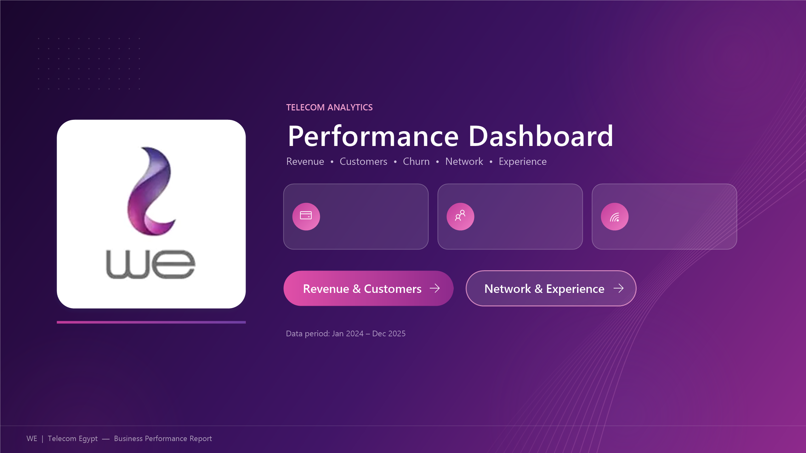

# WE Telecom – Performance Dashboard (Power BI)

A three-page Power BI report for WE (Telecom Egypt) covering revenue, customers, churn, network quality and customer experience from Jan 2024 to Dec 2025.



## Report pages

| Page | What it shows |
|------|---------------|
| **Home** | Landing page with the WE logo, 3 headline KPIs (Total Revenue, Active Customers, Network Availability) and buttons to each analysis page |
| **Dashboard – Revenue & Customers** | KPIs: Total Revenue, Gross Profit, Gross Margin %, ARPU, Active Customers, Churn Rate. Charts: Revenue & ARPU trend, Revenue by Region, Revenue by Plan, Churn Rate by Segment, Regional Summary table |
| **Network & Experience** | KPIs: Network Availability %, Dropped Call Rate, Total Calls, NPS, CSAT, First Contact Resolution. Charts: Dropped Call Rate vs Availability trend, Dropped Calls by Region, CSAT & NPS by Interaction Type, New Customers by Channel, Acquisition Cost by Channel |

Each page has a Year filter and navigation buttons (Ctrl+click in Power BI Desktop).

## Data model

Star schema built from CSV files in [`data/WE_DATA`](data/WE_DATA):

- **Facts:** `Fact_Revenue`, `Fact_Churn`, `Fact_Acquisition`, `Fact_Network`, `Fact_Experience` (one CSV per month, combined with Power Query folder imports)
- **Dimensions:** `Dim_Date`, `Dim_Customer`, `Dim_Geography`, `Dim_Plan`, `Dim_Channel`
- **Measures:** kept in a dedicated `Measure` table, grouped into folders (Revenue, Acquisition, Churn, Experience, Network)

## Project structure

```
WE_DATA_Power_Bi.pbip              # open this in Power BI Desktop
WE_DATA_Power_Bi.Report/           # report pages & visuals (PBIR format)
WE_DATA_Power_Bi.SemanticModel/    # data model, measures, relationships (TMDL)
data/WE_DATA/                      # source CSV files
assets/                            # backgrounds and logo used in the report
scripts/                           # scripts that generated the backgrounds and page layouts
```

## How to open

1. Install [Power BI Desktop](https://powerbi.microsoft.com/desktop/) (with Power BI Project / PBIR support).
2. Clone this repo and open `WE_DATA_Power_Bi.pbip`.
3. The queries point to `C:\Users\owner\Downloads\Data\WE_DATA`. To refresh on your machine, go to **Transform data → Data source settings**, select **Change Source**, choose the `data/WE_DATA` folder of this repo, then select **Refresh**.

## Built with

- Power BI Desktop (PBIP / PBIR + TMDL)
- DAX measures for ARPU, Gross Margin %, Churn Rate, CAC, Network Availability and more
- Custom backgrounds generated with PowerShell (System.Drawing) – see `scripts/make_assets.ps1`
